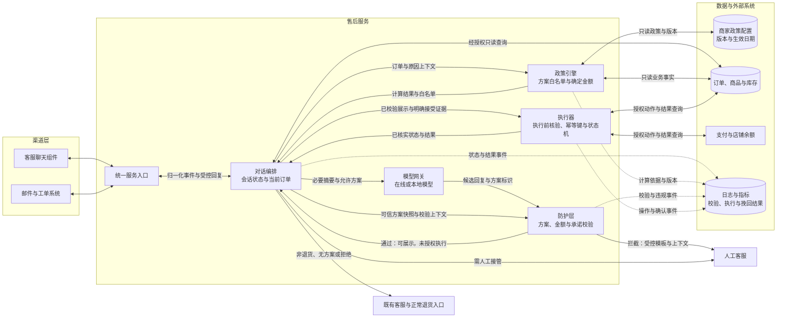

# 产品架构设计规范

用于设计和评审退货客服的模块职责、可信数据流与业务执行边界。以下为逻辑架构：各模块可在同一应用中实现，也可按现有系统拆分；不要求特定框架、模型、渠道或部署方式。

## 产品架构图

实线表示请求、结果或控制流，双向线表示请求及响应；虚线表示审计事件。图上的连线不授予额外权限：防护通过只允许展示该版本方案，编排提交执行请求后，执行器仍须独立核对已保存的展示与同意证据。渠道出口只能发送已校验内容、受控模板或已核实结果通知。

## 模块职责与权限

| 模块 | 输入与职责 | 输出及权限边界 |
| --- | --- | --- |
| 渠道适配与统一入口 | 接收聊天、邮件或工单；归一化消息；关联事件与会话；验证渠道请求并防重复接收 | 向编排传递消息及可信身份引用；消息文字本身不是订单权限或接受证明；不能写订单或资金 |
| 对话编排 | 管理意图、当前订单与商品、原因、协商次数、展示记录、接受证据及路由状态 | 协调查询、计算、生成、校验和执行；持久化后再推进状态；不以模型的“成功”自述更新业务结果 |
| 政策引擎 | 读取带版本及生效期的政策，结合订单、商品、库存、期限与额度计算 | 输出有状态的方案白名单、确定金额和条款；只读业务数据，不发送权益或执行订单操作 |
| 模型网关 | 对接在线或本地模型；按任务提供必要摘要与固定输出契约 | 提取意图、原因或生成候选回复；方案回复沿用 `reply` 与 `offer_id` 契约；不持有业务写权限 |
| 防护层 | 读取可信白名单、政策和展示上下文，检查最终对客全文 | 返回通过或拦截及原因；通过回编排展示，失败使用受控模板并转人工；不能直接执行方案 |
| 执行器 | 从存储核对展示、同意与方案快照，重新核验当前资格，持久化幂等操作 | 在被授权的订单或资金范围内执行、查询和确认；管理 `pending`、`confirmed`、`failed`、`unknown`，不自行更换方案 |
| 人工与既有流程 | 接收自动处理不能完成、被拦截、正常退货或非退货请求 | 带必要上下文和未决操作交接，记录交接结果；正常退货不等于自动批准退款 |
| 日志与指标 | 关联政策计算、校验、展示、同意、执行与最终结果事件 | 脱敏记录并去重统计，不能反向成为政策来源或执行授权；挽回金额口径沿用数据约定 |

会话、方案、展示、同意和操作记录应有持久化的权威存储；可复用现有数据库。进程内历史、模型上下文或一次请求中的布尔标志不能替代这些记录。人工接管沿用已有权限管理，本图不授予人工任意资金操作权限。

## 数据来源与读写边界

- **政策配置**：按版本和生效日期选择，保存本次计算依据。政策更改来自受权的业务配置入口；顾客消息、模型输出和订单备注不能修改政策。
- **订单、商品与库存**：由权威业务接口提供。编排先核验主体与订单归属，再披露详情；政策引擎仅在已授权范围内读取。写入订单或库存相关动作经执行器处理。
- **支付与店铺余额**：只向执行器暴露所需的动作及结果查询权限；凭据不传入模型、渠道消息或公开日志。
- **模型上下文**：只给任务需要的摘要；切换模型实现时保持相同的输入输出契约、校验和权限边界，并遵守接入方允许的模型范围。
- **日志与指标**：从可信模块记录事实和失败原因，关联会话、订单、政策、展示、同意及操作引用；避免复制完整私人对话和联系方式。

## 执行闸门

从编排到执行器的请求必须同时满足以下条件；任一不满足都不调用外部写接口：

1. 当前主体有权处理目标订单和商品，且范围与当前会话一致。
2. 方案来自成功计算的有效白名单，全文校验通过，并有实际展示记录；校验结果必须绑定展示文本、方案及政策版本。
3. 顾客明确接受该展示版本的具体条款，有可关联的 `presentation_id` 与 `consent_event_id`；拒绝、含糊回应或模型推断均不替代证据。
4. 执行器从权威存储核对证据，重新确认库存、政策、期限、金额及关键条款；实质变化时退回编排，重新计算、校验、展示并获得同意。
5. 同一逻辑操作先持久化唯一操作记录、确定参数与幂等键；并发重复请求复用原操作，已确认操作不重复发放，未知操作先查询。

具体字段、参数摘要及结果状态以 [数据与执行约定](contracts.md) 为准；会话转换以 [流程与状态](workflow.md) 为准。图中的执行路径适用于已接受方案，不能被解释成“只要模型推荐即可执行”。

## 禁止绕过的路径

- 渠道或模型直接调用订单、库存、支付、余额写接口。
- 模型生成的方案、金额或“已同意”声明直接进入执行器。
- 候选回复绕过防护层发送给顾客；防护通过后绕过接受环节执行。
- 调用方仅传 `approved: true` 或 `accepted: true`，执行器不读取关联证据就信任。
- 政策引擎或防护层附带执行副作用，或者在校验失败后继续让模型重写到通过。
- 将日志中的旧金额、旧方案或未核实事件当作当前有效白名单或成功凭证。

## 故障与交接

| 故障或事件 | 架构要求 |
| --- | --- |
| 模型不可用或超时，尚未取得候选 | 按配置有限等待或重试；不能切换到接入方未允许的模型或降低校验。无法完成时受控模板、人工交接，无业务写入 |
| 已取得候选，但输出不合法 | 直接按防护失败使用受控模板、转人工并记录；不能以模型重试为由重新生成到通过 |
| 政策或业务数据不可用 | 记录故障并转人工，不伪装成成功计算的空白名单 |
| 防护拦截 | 阻止候选外发，使用受控模板、转人工并记录原因 |
| 顾客拒绝或有效白名单为空 | 正常退货优先；非退货转既有客服；不得靠模块故障或换渠道重新开始挽留 |
| 执行超时或状态未知 | 保留原操作与幂等键，查询确认；缺少安全恢复保证时人工对账 |
| 业务成功、通知失败 | 仅恢复通知；执行器不重复执行业务动作 |
| 进程重启、重复消息或回调 | 从持久化状态恢复；关联原操作与证据，不因内存丢失重新发放或重置协商次数 |

架构验收见 [行为验收中的架构场景](acceptance.md#架构验收场景)。落地交付至少给出图中模块到现有代码的对应、读写权限、执行闸门、失败出口与观测证据；不要为了匹配图形而强制新建多个服务。
